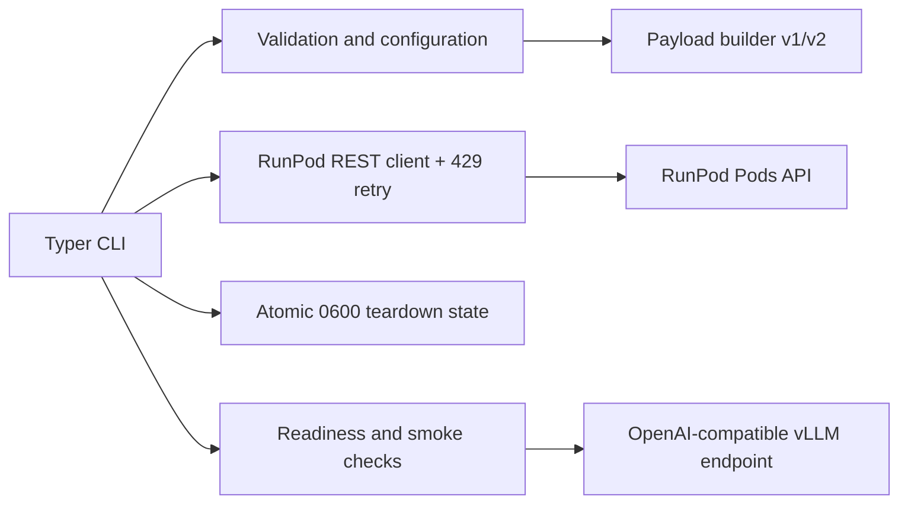

# RunPod vLLM Deployer

[](https://www.python.org/)
[](LICENSE)
[](https://skills.sh/1solomonwakhungu/runpod-vllm-deployer)

**Spin up and tear down OpenAI-compatible vLLM servers on RunPod GPU Pods without leaking GPU bills or debugging 502 startup errors.**

A lightweight Python CLI (`httpx` + `typer`, zero daemon, zero SSH) and portable AI Agent Skill built for RunPod REST API v2. Plan offline, confirm before anything billable, verify `/health` + `/v1/models` + a deterministic chat smoke test, and confirm the Pod is actually gone before local state is removed.

[Project Site](https://runpod-vllm-deployer.vercel.app) | [Quickstart](docs/quickstart.md) | [Configuration](docs/configuration.md) | [Security Model](docs/security.md) | [Agent Skill](https://skills.sh/1solomonwakhungu/runpod-vllm-deployer)

> **Billing note:** RunPod GPU Pods are billable until terminated. Review [RunPod's live GPU pricing](https://www.runpod.io/pricing) before confirming a deploy.

---

## Why this exists

Deploying vLLM on RunPod Pods by hand or letting an AI coding agent run raw API calls usually breaks in two ways:

1. **You spin up a Pod you did not mean to, or lose track of one that is still billing.**
2. **RunPod reports `RUNNING` while vLLM is still downloading weights**, so requests hit HTTP 502 on `.proxy.runpod.net` or fail later on bad vLLM flags.

`runpod-vllm` closes both gaps with a strict five-step lifecycle (`plan -> deploy -> wait -> smoke-test -> destroy`):

- **Offline planning first:** `plan` validates every flag (model ID, GPU profile, tensor-parallel divisibility, disk/RAM/context bounds, non-`latest` image tag) and prints the exact redacted RunPod REST payload with **no API key and no network call**.
- **Approval gates before spend or teardown:** Only `deploy` creates a billable Pod and only `destroy` deletes one. Both prompt interactively unless you explicitly pass `--yes`.
- **Teardown-first atomic state:** Immediately after `POST /pods` returns a Pod ID, the CLI writes `.runpod-vllm-state.json` atomically with mode `0600` (never storing credentials). If creation times out, returns 5xx, or state saving fails, it never blindly retries the billable `POST` and prints an explicit recovery command.
- **Verified readiness and teardown:** `wait` polls both `/health` and `/v1/models`, `smoke-test` sends a deterministic 4-token `/v1/chat/completions` request, and `destroy` polls RunPod until HTTP 404 or `TERMINATED` before deleting local state.
- **RunPod REST v2 native + 429 retries:** Automatically targets RunPod REST API v2 (`https://api.runpod.io/v2`) following the 2026-11-15 v1 retirement, migrates older v1 state files on `status`/`destroy`, and retries HTTP 429 responses with `Retry-After` / jittered exponential backoff.
- **Built for humans and AI agents:** Ships a portable [Agent Skill](skills/runpod-vllm-gpu-deploy/SKILL.md) and Claude Code project skill with hard safety boundaries and stable exit codes (`0` OK, `2` Usage, `3` Config, `4` Auth, `5` Network, `6` API, `7` Timeout, `8` State).

## Try it offline in 30 seconds

No `RUNPOD_API_KEY` required. Validate a config and inspect the exact RunPod REST v2 payload before spending a cent:

```bash
runpod-vllm plan \
  --model Qwen/Qwen3-8B \
  --gpu A40 \
  --max-model-len 8192
```

Example output (offline; no API call):

```json
{
  "cloud": "SECURE",
  "disk": 50,
  "entrypoint": [
    "vllm",
    "serve",
    "Qwen/Qwen3-8B",
    "--host",
    "0.0.0.0",
    "--port",
    "8000",
    "--tensor-parallel-size",
    "1",
    "--max-model-len",
    "8192",
    "--gpu-memory-utilization",
    "0.9",
    "--dtype",
    "auto",
    "--kv-cache-dtype",
    "auto"
  ],
  "env": {},
  "gpu": {
    "count": 1,
    "id": "NVIDIA A40",
    "minRamPerGpu": 16,
    "minVcpuCountPerGpu": 4
  },
  "image": "vllm/vllm-openai:v0.19.1",
  "mounts": {
    "persistent": {
      "path": "/workspace",
      "size": 40
    }
  },
  "name": "vllm-server",
  "ports": [
    "8000/http"
  ]
}
```

## Installation

Python 3.11 or newer is required.

### Release wheel (v0.1.0)

Each release on the [Releases page](https://github.com/1solomonwakhungu/runpod-vllm-deployer/releases) includes a wheel and source distribution:

```bash
python -m pip install https://github.com/1solomonwakhungu/runpod-vllm-deployer/releases/download/v0.1.0/runpod_vllm_deployer-0.1.0-py3-none-any.whl
runpod-vllm --help
```

<!-- Move this block above "Release wheel" once v0.1.0 is published to PyPI via RELEASING.md -->
### PyPI (once published)

```bash
python -m pip install runpod-vllm-deployer
# Or run offline planning with uvx without creating a virtualenv:
uvx --from runpod-vllm-deployer runpod-vllm plan --model Qwen/Qwen3-8B --gpu A40
```

### From source

```bash
git clone https://github.com/1solomonwakhungu/runpod-vllm-deployer.git
cd runpod-vllm-deployer
python3 -m venv .venv
source .venv/bin/activate
python -m pip install .
runpod-vllm --help
```

For development, run `make setup` instead of `python -m pip install .`.

## Five-minute quickstart

1. **Create a local `.env` file** (ignored by Git):

   ```bash
   cp .env.example .env
   # Set RUNPOD_API_KEY in .env (and optional HF_TOKEN for gated models).
   ```

2. **Plan offline** (no API key, no network request):

   ```bash
   runpod-vllm plan \
     --model Qwen/Qwen3-8B \
     --gpu A40 \
     --max-model-len 8192
   ```

3. **Deploy** (billable; prompts for confirmation):

   ```bash
   runpod-vllm --env-file .env deploy \
     --model Qwen/Qwen3-8B \
     --gpu A40 \
     --max-model-len 8192
   ```

4. **Wait for vLLM readiness and run the smoke test:**

   ```bash
   runpod-vllm --env-file .env status
   runpod-vllm wait --timeout 900
   runpod-vllm smoke-test
   ```

5. **Call your OpenAI-compatible endpoint** using the `Base URL` printed by `status` (`https://<POD_ID>-8000.proxy.runpod.net`):

   With `curl`:

   ```bash
   curl https://<POD_ID>-8000.proxy.runpod.net/v1/chat/completions \
     -H "Content-Type: application/json" \
     -d '{
       "model": "Qwen/Qwen3-8B",
       "messages": [{"role": "user", "content": "Hello from RunPod vLLM!"}]
     }'
   ```

   Or with the Python `openai` SDK:

   ```python
   from openai import OpenAI

   client = OpenAI(base_url="https://<POD_ID>-8000.proxy.runpod.net/v1", api_key="EMPTY")
   response = client.chat.completions.create(
       model="Qwen/Qwen3-8B", messages=[{"role": "user", "content": "Hello from RunPod vLLM!"}]
   )
   print(response.choices[0].message.content)
   ```

6. **Tear down and verify the Pod is gone:**

   ```bash
   runpod-vllm --env-file .env destroy
   ```

For unattended runs after reviewing the plan, pass `--yes` (`-y`) to `deploy` or `destroy`.

## How it compares

| Approach | Setup footprint | Offline plan + secret redaction | vLLM readiness + smoke test | Verified teardown | AI Agent Skill |
| --- | --- | --- | --- | --- | --- |
| **`runpod-vllm-deployer`** | 2 Python deps (`httpx`, `typer`), zero daemon | Yes | Yes (`/health`, `/v1/models`, chat completion) | Yes (polls until 404 or `TERMINATED`) | Yes (`skills.sh` + Claude Code) |
| **RunPod Web UI / `runpodctl`** | Browser or Go CLI | No | Manual | Manual | No |
| **SkyPilot / dstack** | Multi-cloud stack or control-plane server | YAML config | Custom script | Orchestrator-managed | No |

Use `runpod-vllm-deployer` when you want a fast, auditable, RunPod-native CLI for ephemeral OpenAI-compatible vLLM Pods without standing up a multi-cloud orchestrator.

## Commands

Global options (`--state-path`, `--env-file`, `--api-url`, `--api-version`) must appear **before** the subcommand.

| Command | Network | Mutates RunPod | Purpose |
| --- | --- | --- | --- |
| `plan` | No | No | Validate configuration and print a redacted payload |
| `deploy` | Yes | Yes, billable | Create a GPU Pod and immediately save teardown state |
| `status` | Yes | No | Inspect the recorded Pod and display access URLs |
| `wait` | Yes | No | Poll `/health` and `/v1/models` until ready |
| `smoke-test` | Yes | No | Send a four-token deterministic chat request |
| `list` | Yes | No | List active GPU Pods |
| `destroy` | Yes | Yes | Delete, verify absence, then remove matching state |

The default state file is `.runpod-vllm-state.json`. Pass `--state-path PATH` before the command to manage multiple Pods from the same directory.

## Supported GPUs and configuration

Supported `--gpu` profiles: `A40`, `L40S`, `A100` (SXM4 80GB), `H100` (80GB HBM3), `H200`, and `B200` (1 to 8 GPUs with validated `--tensor-parallel-size`).

- **Pinned default image:** `vllm/vllm-openai:v0.19.1`. Override with `--image REPOSITORY:TAG` (`:latest` is rejected).
- **vLLM & placement options:** `--revision`, `--max-model-len`, `--gpu-memory-utilization`, `--dtype`, `--quantization`, `--kv-cache-dtype`, `--trust-remote-code`, `--reasoning-parser`, `--container-disk-gb`, `--volume-gb`, `--min-vcpu-per-gpu`, `--min-ram-per-gpu`, `--cloud-type` (`SECURE` or `COMMUNITY`), repeatable `--data-center`, `--port`, and repeatable `--env KEY=VALUE`.
- **Sizing note:** GPU profiles map to RunPod GPU type IDs and do not guarantee a checkpoint fits. Verify checkpoint VRAM, quantization, KV cache, and tensor-parallel requirements against model and vLLM documentation.

See [docs/configuration.md](docs/configuration.md) for all flags and [examples/](examples/) for single-GPU and multi-GPU commands.

### RunPod REST API v2

RunPod retired REST API v1 (`https://rest.runpod.io/v1`) on **2026-11-15**. The CLI automatically defaults to REST API v2 (`https://api.runpod.io/v2`) from that date onward and automatically moves older v1 state files to v2 on `status` and `destroy` using the same Pod ID. You can still set `--api-version` or `RUNPOD_API_VERSION` explicitly when needed. See [docs/configuration.md#runpod-rest-api-version](docs/configuration.md#runpod-rest-api-version) for field mappings.

## AI agent skills

Give Claude Code or any Agent Skills-compatible coding agent safe RunPod GPU operations with built-in approval gates:

```bash
npx skills add 1solomonwakhungu/runpod-vllm-deployer --skill runpod-vllm-gpu-deploy
```

- Portable skill: [skills/runpod-vllm-gpu-deploy/SKILL.md](skills/runpod-vllm-gpu-deploy/SKILL.md)
- Claude Code project skill: [.claude/skills/runpod-vllm-gpu-deploy/SKILL.md](.claude/skills/runpod-vllm-gpu-deploy/SKILL.md) (kept byte-identical by automated tests)

This installs the agent instructions, not the Python package. Install `runpod-vllm` first so the agent can invoke the CLI.

## Architecture and security



- Credentials are read only from `RUNPOD_API_KEY`, optional `HF_TOKEN`, optional `VLLM_API_KEY` (or `--bearer-token-env`), or an explicit `--env-file`.
- Secrets are never written to state files; plans and network diagnostics redact sensitive keys, bearer tokens, and URL credentials on a best-effort basis.
- Deep dives: [Architecture](docs/architecture.md) | [Lifecycle Safety](docs/lifecycle.md) | [Security](docs/security.md) | [Troubleshooting](docs/troubleshooting.md)

## Development and testing

No test contacts RunPod. The offline suite exercises mocked HTTP responses, REST v2 cutover, agent skill parity, and lifecycle fault injection (`429`, `502`/`503`/`504`, timeouts, and state-save failures).

```bash
make setup
make check
```

Individual targets: `make test`, `make lint`, `make format`, `make typecheck`. Releases are automated; see [RELEASING.md](RELEASING.md) and [CHANGELOG.md](CHANGELOG.md).

## Contributing & License

Contributions are welcome. Read [CONTRIBUTING.md](CONTRIBUTING.md) and [CODE_OF_CONDUCT.md](CODE_OF_CONDUCT.md), then run `make check` before opening a pull request. Report vulnerabilities via [SECURITY.md](SECURITY.md).

Licensed under the [Apache License 2.0](LICENSE). Copyright 2026 Solomon Wakhungu.
