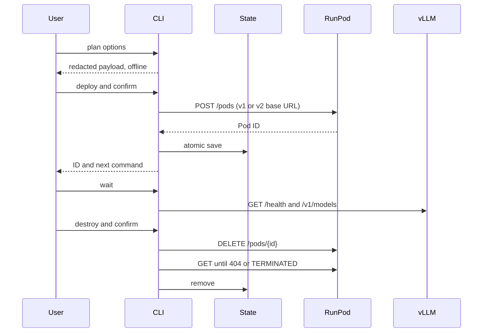

# Architecture

The package keeps unsafe boundaries narrow and testable.

| Module | Responsibility |
| --- | --- |
| `cli.py` | User interaction, confirmations, exit codes, and command orchestration |
| `config.py` | Input validation, GPU profiles, env-file loading, and name sanitization |
| `payload.py` | Pure construction of RunPod REST payloads and vLLM arguments |
| `client.py` | Authenticated RunPod REST requests and safe error translation |
| `models.py` | Typed state and readiness results |
| `state.py` | Atomic, restrictive, credential-free teardown state |
| `readiness.py` | Bounded health polling and deterministic endpoint smoke tests |
| `redaction.py` | Recursive structured redaction and safe diagnostics |
| `errors.py` | Domain errors and stable process exit codes |

## Data flow

## Failure strategy

Configuration fails before network activity. API and transport failures become concise domain errors with redacted URLs and bodies. Once creation returns an ID, state persistence is the highest-priority action. A failure at that point prints the ID and a direct cleanup command.

Deletion state is removed only after the provider reports the Pod absent. This makes retries safe and preserves the identifier needed to stop billing.

## API conventions

The CLI supports two RunPod REST surfaces, selected with `--api-version`. The default is `v1` before 2026-11-15, when RunPod retires v1, and `v2` from that date.

| | REST v1 | REST v2 |
| --- | --- | --- |
| Base URL | `https://rest.runpod.io/v1` | `https://api.runpod.io/v2` |
| Create | `POST /pods` (flat body) | `POST /pods` (nested `CreatePodRequest`, 201) |
| Read | `GET /pods/{id}`, status in `desiredStatus` | `GET /pods/{id}`, status in `status` |
| List | `GET /pods?computeType=GPU`, bare array | `GET /pods`, `{"pods": [...], "pagination": {...}}` with cursor pages; CPU Pods filtered out client-side |
| Delete | `DELETE /pods/{id}` | `DELETE /pods/{id}` (204) |
| Errors | `{"message": ...}` | RFC 9457 `{"title", "status", "detail"}` |

v1 create fields are `imageName`, `gpuTypeIds`, `gpuCount`, `minVCPUPerGPU`, `minRAMPerGPU`, `dockerEntrypoint`, `dockerStartCmd`, `ports`, `cloudType`, and optional `dataCenterIds`. The v2 mapping is in [Configuration](configuration.md#runpod-rest-api-version).

Version differences stay in three places: `payload.build_pod_payload` builds the body for the selected version, `RunPodClient` unwraps the v2 list envelope and follows its cursor, and `models.normalize_pod` maps either Pod shape onto `PodInfo` (ID, name, status, GPU count). The rest of the CLI reads only `PodInfo`. Deletion verification treats a 404 or a `TERMINATED` status as absent, because v2 documents `TERMINATED` as permanently deleted.

`deploy` records `api_version` and `api_url` in state so `status` and `destroy` use the surface the Pod was created with. The proxy URL `https://{podId}-{port}.proxy.runpod.net` is the same for both versions; the v2 Pod schema does not document a proxy URL field, so this is an assumption for v2. The implementation intentionally avoids the legacy GraphQL path.
